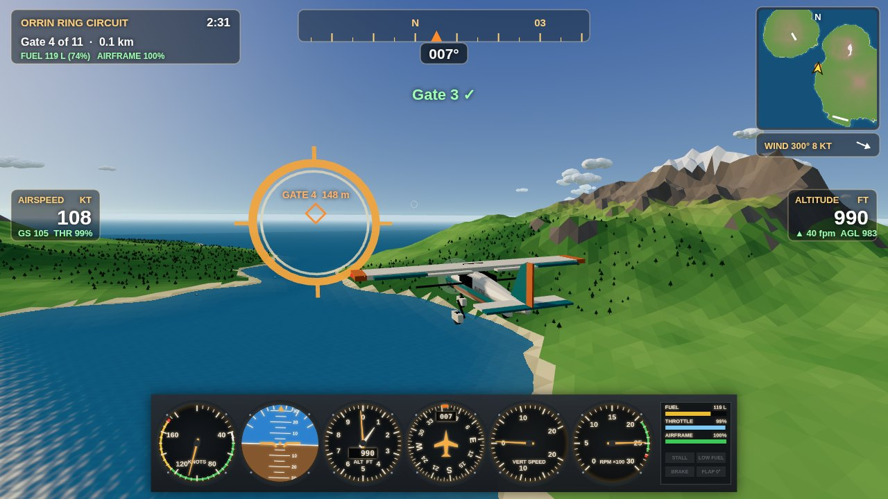
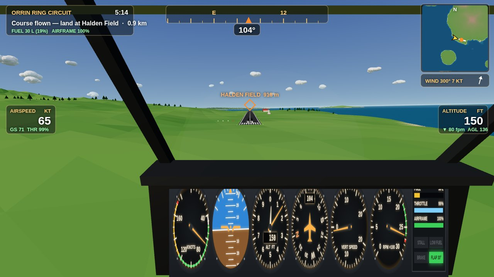
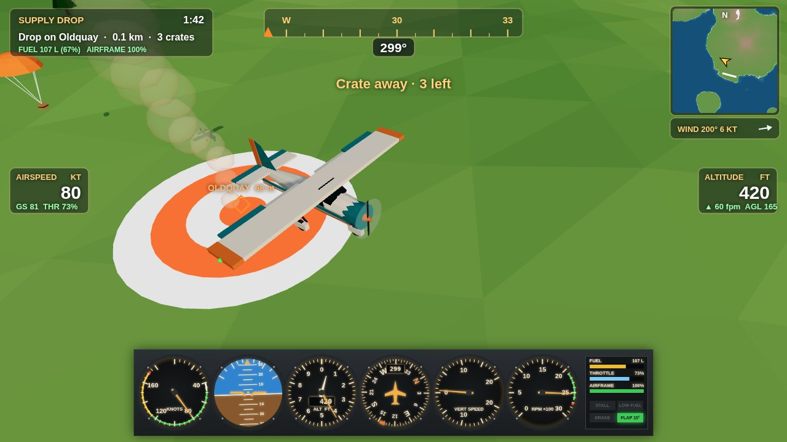
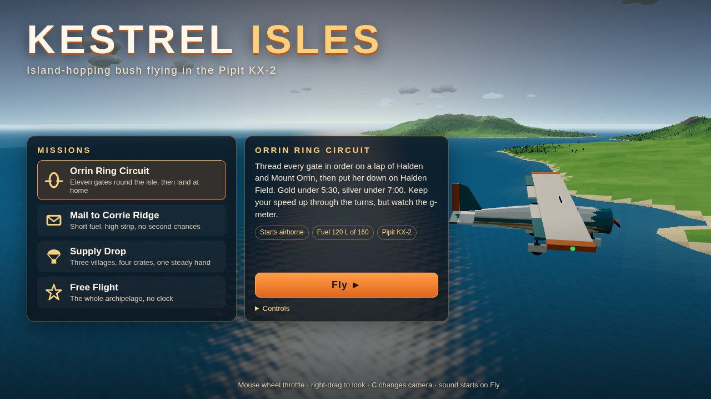

# Kestrel Isles

[](https://make.fun/bounty/best-flight-game-20261126-0057)
[](https://make.fun/bounty/best-flight-game-20261126-0057)
[](https://make.fun/bounty/best-flight-game-20261126-0057)

**Island-hopping bush flying in the browser.** Fly the Pipit KX-2, a two-seat high-wing island
hopper, around the Kestrel Isles: a sunlit archipelago with a snow-capped volcano, forests, fishing
villages, a lighthouse and three airstrips. It's an original game (world, aircraft, names, art and
sound are all made for it), entered in the make.fun bounty
[Make the best flight game](https://make.fun/bounty/best-flight-game-20261126-0057).



| Cockpit, short final into Halden Field | Supply drop over Oldquay | Mission board |
|---|---|---|
|  |  |  |

## Missions

- **Orrin Ring Circuit**: thread eleven gates around Halden and Mount Orrin against the clock, then
  land back at Halden Field. Gold under 5:30. Missing a gate costs 20 seconds.
- **Mail to Corrie Ridge**: a fuel-limited ferry with 52 litres. Fly lean, climb over the ridge and
  land on a 620 m gravel strip at 780 ft with a hill beyond it, so there's no go-around.
- **Supply Drop**: three villages, four crates. Make low, slow passes over the smoking targets and
  release with Space. Crates drift with the wind under their parachutes and are scored on distance
  from the centre. Then land at home.
- **Free Flight**: full tanks and no clock. Refuel at any strip; Halden's hangar crew repair damage.

Each sortie ends in a debrief with time, score, touchdown grade (Butter, Smooth, Firm or Hard, with
the sink rate in ft/min), fuel left, airframe health and peak g.

## Flying

The flight model works from angle of attack: lift that stalls past about 15° (with a horn and a wing
drop), drag that grows with lift, flaps and sideslip, and a propeller whose pull fades with speed.
Controls bite harder as airspeed builds. Weathervane stability keeps the nose into the relative wind,
so you trim speed with the throttle and hold turns with back pressure. A gusting breeze changes
your airspeed and groundspeed, swings the windsocks and pushes parachutes off target. Over-g,
overspeed and hard landings damage the airframe; a damaged engine loses power and trails smoke. Run
the tank dry and you're gliding.

| Keys | Action |
|---|---|
| W / S or ↑ / ↓ | Pitch nose down / up |
| A / D or ← / → | Roll |
| Q / E | Rudder (nosewheel steering on the ground) |
| Shift / Z, mouse wheel, 1–0 | Throttle up / down / set |
| F | Flaps 0 / 15° / 30° |
| B, or Space on the ground | Wheel brakes |
| Space in the air | Release a supply crate |
| C | Chase, cockpit, flyby and tower cameras |
| Right-drag | Look around |
| M | Mouse yoke |
| P or Esc | Pause; N mutes the sound |

The HUD shows airspeed, altitude with vertical speed and height above ground, a heading tape with a
bug on the objective, a pointer to the target, the wind, and a minimap. The backlit panel
(airspeed, attitude, altimeter, heading, vertical speed, tachometer, fuel, throttle, airframe and
warning lamps) sits under the chase view and is the real panel in the cockpit. PAPI lights beside
each runway turn red or white as you come down the glide slope.

## Run it

The game is plain static files in `game/`, with no build step and no network requests. Serve them
and open the page in a desktop browser:

```sh
node serve.ts          # http://localhost:8080
```

## How it's built

`game/src/` holds one module per job: `islands.js` (geography and ground height), `terrain.js`
(the flat-shaded mesh and the height queries the wheels use), `sky.js`, `water.js`, `runways.js`,
`scenery.js`, `aircraft-model.js`, `flight-model.js`, `autopilot.js`, `input.js`,
`camera-rig.js`, `instruments.js`, `hud.js`, `missions.js`, `markers.js`, `cargo.js`,
`effects.js`, `audio.js` (all sound is synthesised with WebAudio), `menu.js`, `shots.js` and
`main.js`. three.js r187 is vendored as `game/vendor/three.min.js` (MIT, licence alongside).

The screenshots are real renders. `node tools/capture-shots.mjs` opens each `?shot=` scene listed
in `shots.json` in headless Chromium. Each scene starts a real mission and lets the autopilot fly
the flight model for a few seconds before the frame is captured.

`main.ts` hands the entry in: it copies `game/` and `screenshots/` to the output directory and
writes `dossier.json` with the kit's `vendor/makefun-game.ts`.

## License

MIT, see [LICENSE](LICENSE).
